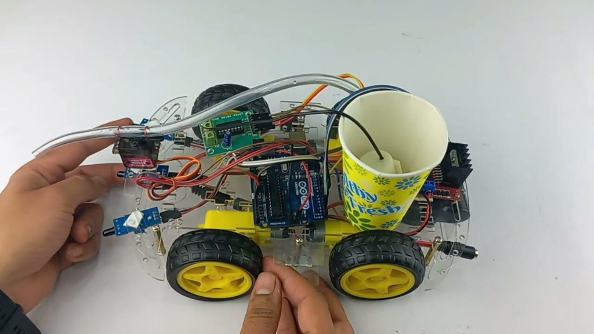
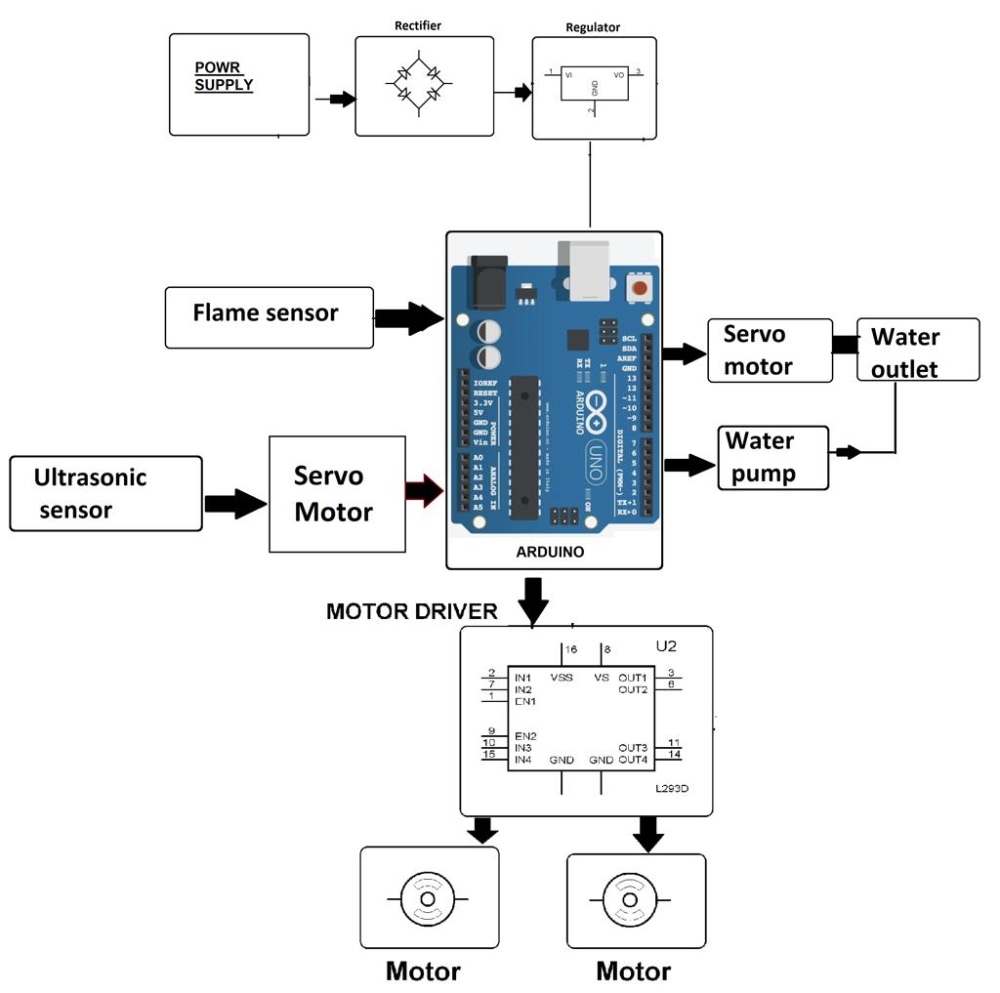
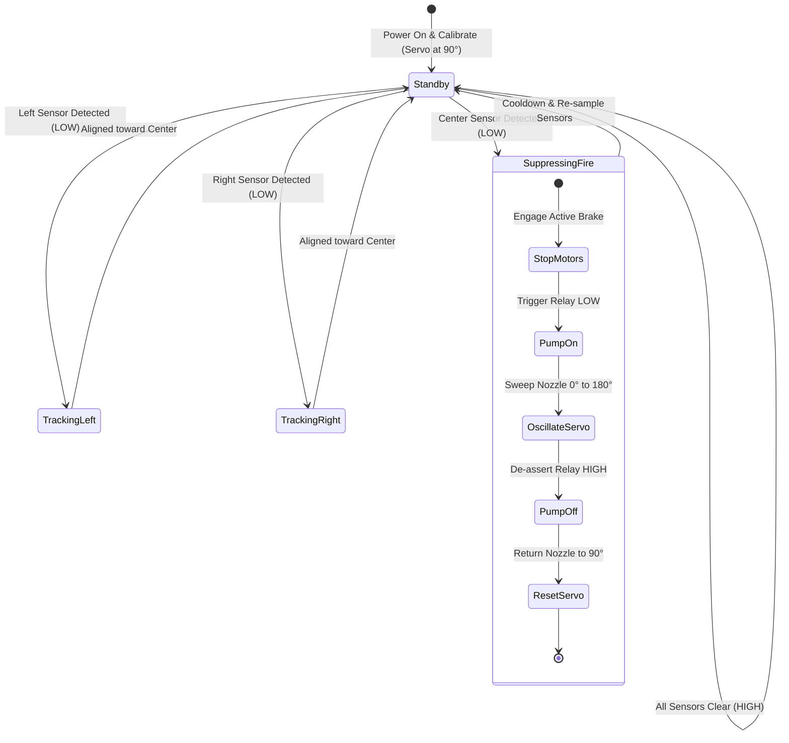

# 🚒 AquaFlare — Autonomous Firefighting Robot

<div align="center">

[](https://www.arduino.cc/)
[](https://isocpp.org/)
[](LICENSE)
[](#)
[](#)

<p align="center">
  <b>An Arduino-powered autonomous mobile robotics platform engineered to detect fire signatures via multi-channel infrared triangulation, navigate toward the hazard, and execute high-coverage flame suppression using an optocoupled water pump and 180° oscillating servo nozzle.</b>
</p>

[Explore Docs](docs/) • [Circuit Diagram](docs/circuit_diagram.md) • [Hardware Assembly](docs/hardware_setup.md) • [Interview Guide](docs/interview_guide.md) • [Firmware Code](src/AquaFlare/AquaFlare.ino)

---

### 📸 Physical Prototype & System Overview

| Assembled Robot Prototype | System Architecture Block Diagram |
|:---:|:---:|
|  |  |

</div>

---

## 🌟 Overview: What is AquaFlare?

In emergency fire scenarios, direct human intervention poses severe risks of burns, toxic smoke inhalation, structural collapse, and asphyxiation. **AquaFlare** is an autonomous proof-of-concept robotic platform designed to mitigate human risk by scouting controlled demonstration environments, locating localized flame outbreaks, navigating directly to the source, and discharging water across a 180° arc without requiring continuous manual remote control.

The system's name encapsulates its core duality:
- **Aqua:** High-pressure water suppression payload.
- **Flare:** Target flame emission detected via targeted optical spectrum sensors.

> [!NOTE]
> *AquaFlare is an educational proof-of-concept embedded robotics demonstration and serves as a foundational prototype for industrial and search-and-rescue autonomous hazard-mitigation systems.*

---

## 🚀 Key Features

- 🔥 **3-Zone Optical Fire Triangulation:** Employs three photodiode sensors positioned at $-45^\circ$, $0^\circ$, and $+45^\circ$ to locate the exact angular bearing of the flame.
- ⚙️ **Differential Drive Locomotion:** Controlled by an L298N dual full-bridge driver, enabling instantaneous in-place pivoting, forward cruising, and precision braking.
- 🌊 **180° Dynamic Servo Spray Sweeping:** Rather than firing a single stationary jet, the nozzle sweeps continuously from $0^\circ$ to $180^\circ$ via an SG90 micro-servo to maximize flame dousing coverage.
- ⚡ **Optocoupled Relay Isolation:** A 5V relay module provides complete galvanic isolation between the Arduino microcontroller and the inductive inrush/back-EMF spikes of the 9V submersible pump.
- 📊 **Serial Telemetry & Diagnostic Suite:** Dedicated diagnostic firmware (`test/`) allows independent calibration of sensor potentiometers, motor polarity verification, and pump/servo benchmarking.

---

## 📋 Bill of Materials (BOM)

| Component | Quantity | Key Specifications & Purpose |
|---|---|---|
| **Arduino Uno R3** | 1 | ATmega328P 16MHz MCU, executes control algorithms |
| **Flame Sensors** | 3 | IR Photodiode modules (760nm–1100nm) with LM393 comparators |
| **L298N Motor Driver** | 1 | Dual H-bridge driver handling up to 2A per channel |
| **DC Geared Motors** | 4 | Yellow TT gearmotors (3V–6V DC, 1:48 gear ratio) |
| **Submersible Water Pump** | 1 | 3V–9V DC mini pump, submerged in onboard cup reservoir |
| **5V Relay Module** | 1 | Optocoupled 1-channel relay for inductive pump isolation |
| **Servo Motor** | 1 | TowerPro SG90 9g micro-servo for 180° nozzle oscillation |
| **Robot Chassis** | 1 | Transparent acrylic dual-plate chassis with 65mm rubber wheels |
| **Silicone Tubing** | 1 | Flexible 6mm OD clear tubing routing water from reservoir to servo |
| **Power Supply** | 2 | Dedicated battery packs for Arduino logic and high-current motors |

---

## 🔌 Circuit Pinout Matrix

```
       +---------------------------------------------------------+
       |             ARDUINO UNO PIN CONNECTIONS                 |
       +---------------------------------------------------------+
       |  Pin A0   <----   Left Flame Sensor Digital Out (DO)    |
       |  Pin A1   <----   Center Flame Sensor Digital Out (DO)  |
       |  Pin A2   <----   Right Flame Sensor Digital Out (DO)   |
       |  Pin D2   ---->   L298N IN1 (Left Motor Forward)        |
       |  Pin D4   ---->   L298N IN2 (Left Motor Reverse)        |
       |  Pin D5   ---->   L298N ENA (Left Motor PWM Speed)      |
       |  Pin D6   ---->   L298N ENB (Right Motor PWM Speed)     |
       |  Pin D7   ---->   L298N IN3 (Right Motor Forward)       |
       |  Pin D8   ---->   L298N IN4 (Right Motor Reverse)       |
       |  Pin D9   ---->   SG90 Servo PWM Signal Pin             |
       |  Pin D12  ---->   5V Water Pump Relay Control Pin       |
       |  Pin D13  ---->   Status / Telemetry Indicator LED      |
       +---------------------------------------------------------+
```

*For detailed electrical schematics, power rail isolation, and common ground wiring, see [Circuit Diagram Guide](docs/circuit_diagram.md).*

---

## 🔄 Autonomous Control Pipeline



---

## 📁 Repository Structure

```
├── .github/
│   └── workflows/
│       └── arduino-ci.yml        # Automated GitHub Actions firmware verification
├── assets/
│   └── images/
│       ├── aquaflare_prototype.png # Assembled hardware prototype photo
│       └── system_block_diagram.png# High-level architecture block diagram
├── docs/
│   ├── circuit_diagram.md        # Electrical schematics, wiring matrix & power isolation
│   ├── hardware_setup.md         # Mechanical assembly, chassis, and tubing setup guide
│   ├── algorithm_flowchart.md    # Control state machine and sensor truth tables
│   └── interview_guide.md        # Comprehensive technical Q&A for placements and viva
├── src/
│   └── AquaFlare/
│       └── AquaFlare.ino         # Primary autonomous robot firmware
├── test/
│   ├── sensor_calibration.ino    # Real-time serial calibration utility for flame sensors
│   ├── motor_test.ino            # Directional verification suite for L298N motors
│   └── pump_servo_test.ino       # 180° servo sweep & relay bench-test sketch
├── .gitignore                    # Arduino and editor build artifact exclusion
├── LICENSE                       # MIT Open-Source License
└── README.md                     # Project documentation & reference
```

---

## 🛠️ Getting Started & Flashing Guide

### 1. Prerequisites
- [Arduino IDE](https://www.arduino.cc/en/software) (Version 1.8.x or 2.x)
- Standard included libraries: `Servo.h`, `Wire.h`

### 2. Step-by-Step Installation
1. Clone this repository:
   ```bash
   git clone https://github.com/sujaypaul27/Firefighting-Robot-AquaFlare.git
   cd Firefighting-Robot-AquaFlare
   ```
2. Open the main firmware in Arduino IDE:
   ```bash
   src/AquaFlare/AquaFlare.ino
   ```
3. Connect your Arduino Uno to your PC via USB cable.
4. In Arduino IDE:
   - Go to **Tools > Board > Arduino AVR Boards > Arduino Uno**.
   - Select the corresponding COM Port under **Tools > Port**.
5. Click **Upload** (`Ctrl + U`).
6. Open the **Serial Monitor** at **9600 baud** to view live sensor telemetry!

### 3. Hardware Calibration
Before running the autonomous mode:
- **Calibrate Flame Trimmers:** Upload [`test/sensor_calibration.ino`](test/sensor_calibration.ino). Turn each sensor's blue potentiometer until the onboard indicator LED turns OFF under standard ambient room lighting, but switches ON when a lighter is placed 40 cm away.
- **Verify Motor Direction:** Upload [`test/motor_test.ino`](test/motor_test.ino) with wheels elevated to ensure forward/reverse polarity matches left/right wheel orientation.
- **Check Pump & Nozzle:** Upload [`test/pump_servo_test.ino`](test/pump_servo_test.ino) to verify the 180° sweep oscillation and confirm clean water flow.

---

## 🎯 Author & Contribution

**Sujay Paul** — Project Engineering & Implementation  
- **Hardware Integration:** Lead mechanical assembly of the 4WD chassis, component mounting, and wiring harness.
- **Circuit Architecture:** Implemented power rail separation, L298N motor driver interfacing, and relay galvanic protection.
- **Team Coordination:** Task allocation, milestone scheduling, integration testing, and documentation.

---

## 📄 License

This project is licensed under the **MIT License** — see the [LICENSE](LICENSE) file for complete details. Free for academic, personal, and educational use.
