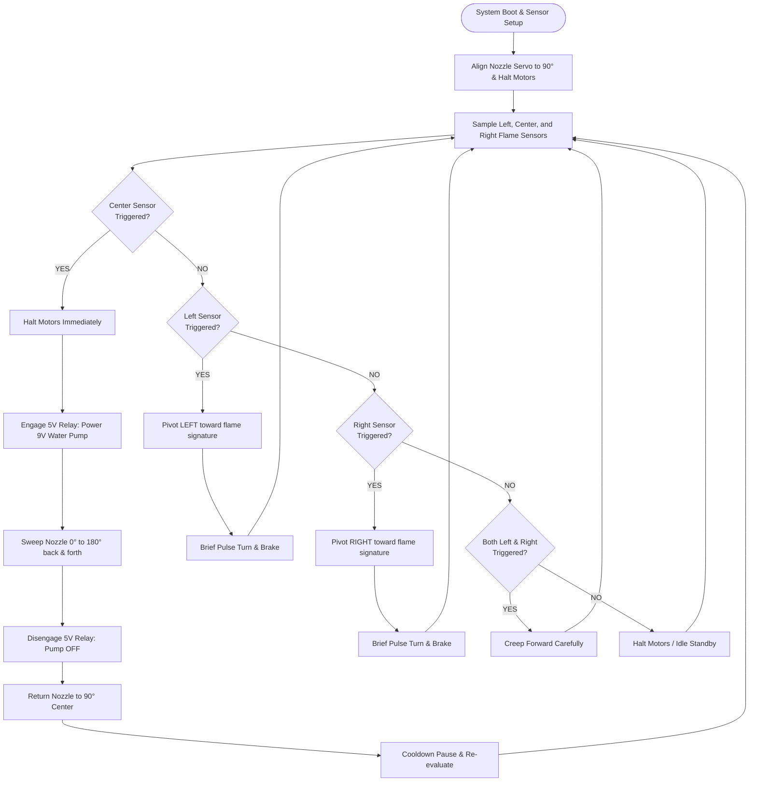

# 🧠 AquaFlare — Control Algorithm & State Machine

This document details the operational flow, sensor truth tables, and autonomous decision-making pipeline of the **AquaFlare** robot.

---

## 📊 System Flowchart

---

## 🎯 Sensor Decision Matrix:

The three flame sensors provide digital outputs where:
- `LOW` ($0$) = **Flame Detected**
- `HIGH` ($1$) = **Clear / Ambient Background**

| Left (A0) | Center (A1) | Right (A2) | System State | Drive Action | Extinguishing Action |
|:---:|:---:|:---:|:---|:---|:---|
| HIGH | **LOW** | HIGH | Fire Ahead | **STOP (0, 0)** | **Pump ON + 180° Servo Sweep** |
| **LOW** | **LOW** | HIGH | Fire Front-Left | **STOP (0, 0)** | **Pump ON + 180° Servo Sweep** |
| HIGH | **LOW** | **LOW** | Fire Front-Right | **STOP (0, 0)** | **Pump ON + 180° Servo Sweep** |
| **LOW** | **LOW** | **LOW** | Fire Engulfing / Point-Blank | **STOP (0, 0)** | **Pump ON + 180° Servo Sweep** |
| **LOW** | HIGH | HIGH | Fire on Left | **Pivot Left (-175, +175)** | Inactive |
| HIGH | HIGH | **LOW** | Fire on Right | **Pivot Right (+175, -175)** | Inactive |
| **LOW** | HIGH | **LOW** | Broad Fire Source | **Advance Forward (+190, +190)** | Inactive |
| HIGH | HIGH | HIGH | No Fire (Clear) | **Stationary / Standby** | Inactive |

---

## 🌊 Extinguishing Protocol Logic
1. **Confirmation & Braking**: Once the center sensor detects flame within range, motors receive active braking (`LOW` on all inputs with `PWM 0`) to prevent momentum from coasting into the fire.
2. **Pump Activation**: Pin 12 asserts `LOW` to activate the optocoupled relay, switching battery power to the 9V pump.
3. **180° Sweeping Coverage**:
   - The servo traverses smoothly from $0^\circ \to 180^\circ$ at $15$ ms per $2^\circ$ step ($\sim 1.35$ seconds).
   - The servo sweeps back from $180^\circ \to 0^\circ$ ($\sim 1.35$ seconds).
   - This completes a dual-sweep pass, covering the full forward hemisphere to ensure complete flame dousing.
4. **Shutdown & Center**: The pump relay is shut off, and the nozzle returns to the neutral $90^\circ$ position.
